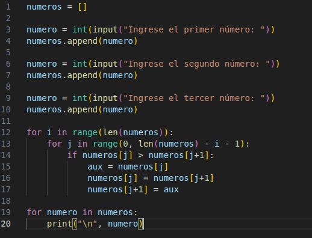
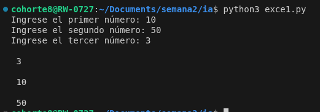

# Algoritmo de ordenamiento.

## Código.

El código que armé es conocido principalmente como "bubble sort", es un código de ordenamiento muy conocido y usado para organizar diferentes cosas dependiendo de lo requerido, por lo general es de menor a mayor. 

## Resultado

En este caso la terminal nos muestra la entrada de 3 números que se almacenan en una variable reusable pero estos son ingresados en un arreglo, lo que ocurre es que se usan 2 búcles, el primero usa la longitud del arreglo para definir el número de vueltas, y el segundo depende de una variable (i que es la variable iniciada en 0 para las vueltas del primer ciclo) para saber la cantidad de vueltas que se deben hacer para poder empezar a hacer las comparaciones del arreglo que contiene los números, esta comparación se debe realizar con un condicional que compara el primer item del arreglo (cuando se hace uso numeros[j] ya que j es el valor de la posición a la que se accede) con el segundo item del arreglo (numeros[j+1]), en caso de que el primer valor sea mayor al segundo entonces se guarda en una variable temporal el primer número y se reemplaza el primer valor del array por el segundo número y seguido se reemplaza el segundo valor del arreglo por el primer número, el proceso se va repitiendo comparando pares hasta que quedan completamente organizados. 